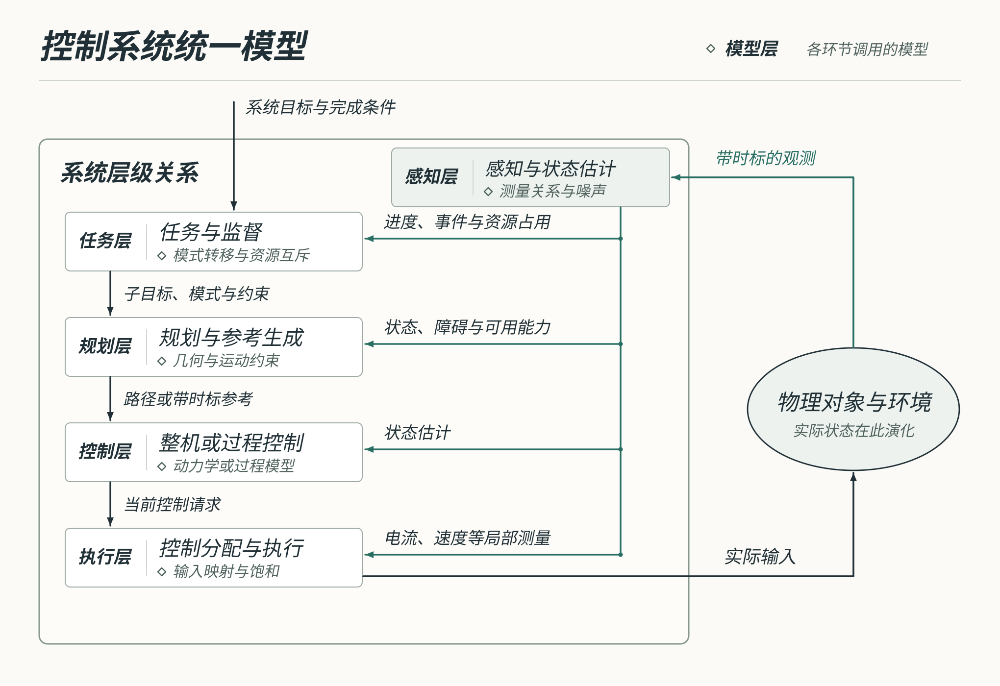
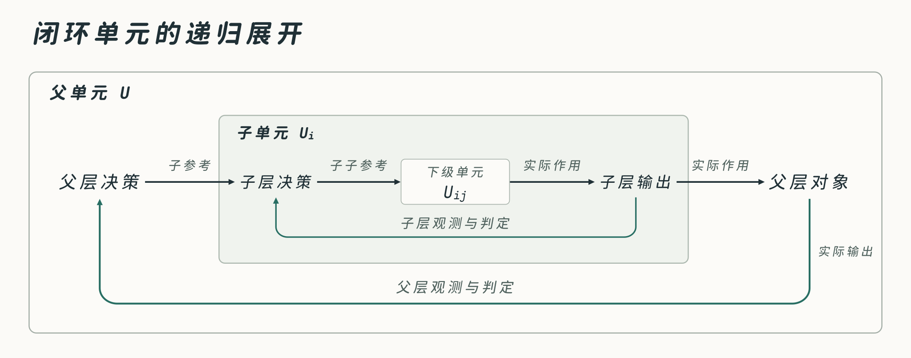

## 一、图一的数学语言与系统大纲

图一从两条跨越边界的线开始读，执行层向物理对象施加**实际输入**，传感器将对象的**观测**送回感知层，框内决定怎样行动，框外的对象在输入和环境扰动下演化，下一次决策再根据已经发生的变化作出修正

选定一个系统边界，记 $r$ 为希望达到的参考，$x$ 为对象的真实状态，$u$ 为实际施加的输入，$y$ 为测量，$z$ 为任务关心的输出，一个连续对象可以写成

| 数学关系 | 含义 |
| --- | --- |
| $\dot{x}=f(x,u,d)$ | 状态怎样随实际输入和扰动变化 |
| $y=h(x,u,n)$ | 传感器能从对象上测到什么 |
| $z=g(x,u,d)$ | 任务最终要控制或验收什么 |

其中 $d$ 表示扰动，$n$ 表示测量噪声，以底盘停车为例，编码器测得的轮速属于 $y$，车身相对工位的位姿才是要验收的 $z$，感知层依据测量和输入历史估计车身状态，控制层用估计结果修正动作，车轮打滑时，轮速仍可能准确跟上命令，停车位置却已经偏了　[MIT 输出反馈讲义](https://underactuated.mit.edu/output_feedback.html)

**系统大纲可以沿三条关系来读**

- **目标向下细化**　任务层确定子目标，规划层生成参考，控制层计算当前控制请求，执行层把请求变为实际输入
- **状态分路反馈**　感知层把局部测量、状态估计、环境变化和任务事件分别送给有权作出修正的层级
- **模型按需调用**　图中的菱形标出各层使用的模型，同一模型可以服务多个层级，物理对象与环境独立画在功能边界之外

## 二、六个功能层各自交付什么

**任务层决定做什么，以及何时算完成**　“把工件送到目标位置”给出了意图，还要明确当前进入哪个阶段、哪些资源可用、满足什么条件才能转入下一阶段，状态机或行为树可以表达这些决策，任务层向下交付的是子目标、模式和约束

**规划层给目标赋予可执行的参考**　目标只规定终点时，规划层还要决定经过哪里、保持怎样的姿态、何时到达，交付物可以是固定设定值、几何路径、带时标的轨迹或动作序列，障碍物变化或下层可用能力下降时，规划层要重新判断原参考是否可行

**控制层决定这一拍怎样纠偏**　参考规定此刻希望对象在哪里、怎样运动，反馈给出对实际运动的估计，控制器据此计算当前所需的速度、力、力矩或功率，PID、LQR 和滚动求解的 MPC 都可以承担相应控制职责，选型取决于可用模型、约束和性能要求

**执行层把整机请求变成物理作用**　例如底盘需要某个车体速度，执行层先求各轮参考，再调用局部伺服和驱动器，轮速、转向速度和电流都有上限，某一项饱和后，上层需要知道下层实际做到了多少，才能决定继续纠偏还是修改参考

**感知层回答机器和环境现在怎样**　局部测量可以直接用于伺服，融合后的位姿可供控制层跟踪，障碍信息可供规划层换路，接触事件可供任务层切换阶段，测量值要带单位、坐标系和采样时刻，两条消息同时抵达控制器，也可能描述不同时刻的运动

**模型层提供各项判断所依赖的关系**　坐标变换把测量和参考放到同一坐标系，运动学联系任务空间与关节或轮系运动，静力学描述载荷传递，动力学描述输入和外力怎样改变运动，执行器模型给出映射与饱和，测量模型联系真实状态与观测，标定和辨识负责确定这些关系中的参数

连续运动可以用状态方程描述，数字控制按采样时刻更新，若机械臂从自由运动转入接触，还要规定哪个事件触发切换、切换后采用哪套运动与受力关系

## 三、从机械臂到底盘，检验 B 样条轨迹规划的迁移

在同一平面上画一道 S 弯，分别要求机械臂的工具尖端和底盘的指定参考点沿线移动，把共同的几何要求写成 B 样条 $p(s)$，其中 $s$ 表示路径进度，再给定时间规律 $s(t)$，合成的 $p(s(t))$ 就是两台机器可以共用的轨迹表达式

对它求两次时间导数，可以看出“曲线平滑”和“机器走得平顺”之间还隔着什么

$$
\ddot p=p^{\prime\prime}(s)\dot s^2+p^\prime(s)\ddot s
$$

沿同一条弯，把路径推进速度加倍，第一项就增至四倍，而起步和制动时怎样改变推进速度，由第二项体现，因此几何曲线、时间规律和执行能力需要分别检查　[Modern Robotics 轨迹生成](https://modernrobotics.northwestern.edu/chapters/chapter9/)

**交给机械臂**，规划层要为工具路径找到连续的关节运动，如果任务还指定工具姿态，逆运动学也要同时满足它，沿途要检查关节限位、奇异位形和碰撞，再按时间规律检查关节速度和力矩，最终依据实际工具轨迹判断跟踪效果

**交给差速底盘**，取驱动轴中点为参考，在低速、纯滚动、向前行驶且路径切线有定义的路段，车头应沿路径切线，所需角速度满足 $\omega=v\kappa$，其中 $v$ 为前进速度，$\kappa$ 为有符号曲率，执行层由此求出左右轮速并检查各轮的速度和加速度，实际跟踪效果要用车身位姿判断

阿克曼底盘还能区分两类在实车上都表现为“跟不上弯”的问题，在低速纯滚动条件下，以后轴中点为参考，若轴距为 0.5 米、最大等效转角为 30°，最小转弯半径约为 0.87 米，样条中若有半径仅 0.6 米的弯，就要改路径，若转角足够而侧向加速度 $v^2\lvert\kappa\rvert$ 过大，则可以保留弯形，在弯前减速　[Modern Robotics 轮式机器人模型](https://modernrobotics.northwestern.edu/nu-gm-book-resource/13-3-1-modeling-of-nonholonomic-wheeled-mobile-robots/)

这次迁移保留下来的是**路径表示、时间参数化和依据误差修正动作的结构**，需要替换的是机构模型、可行性检查、执行映射和任务端观测，同样是过弯偏离，几何不可行由规划层改路径，动作需求超限可以改时间规律，参考可行而跟踪误差过大，则沿控制、执行与感知环节查找原因

## 四、为什么这个模型可以递归展开

图一在整机边界内把执行层画成一项能力，如果它能接收参考、调节自身动作，并依据实际输出纠偏，那么把边界移到这项能力上，就会再次看到一个完整闭环，图二画出的正是这次边界移动

父单元 $U$ 向子单元 $U_{i}$ 发出**子参考**，子层决策再向下级单元 $U_{ij}$ 发出**子子参考**，沿正向路径，下级的实际作用形成子层输出，子层的实际作用再改变父层对象，沿返回路径，子层依据自己的输出纠偏，父层则依据父层对象的输出判断父目标

递归成立的工程条件落在接口上，上层需要知道这项能力接受什么参考、能在多大幅值和变化率下执行、多久生效、受限时返回什么，每移动一次边界，都要重新确定本层的参考、实际输入、观测和完成条件

## 五、从双臂协同系统展开到单臂与关节电机

设两只机械臂从两侧握住同一件刚性工件，任务是把工件搬到指定位姿并稳定保持，夹持点已知，搬运期间保持抓持且无滑移，从外到内选择三个边界，就能把图二的抽象单元逐一落实

**双臂协同系统控制工件**　协同层先给出工件的期望位姿轨迹，再根据两个固定抓持点推导左右末端各自的参考，若以 $O$ 表示工件、$E_{i}$ 表示第 $i$ 个末端、$W$ 表示世界坐标系，两臂参考必须同时满足同一个几何关系

$$
{}^{W}T_{E_i,\mathrm{ref}} = {}^{W}T_{O,\mathrm{ref}}\,{}^{O}T_{E_i} \qquad i\in\{L,R\}
$$

也就是说，工件的期望位姿乘上各自固定的抓持变换，就得到两只手的期望位姿，如果左右臂分别规划了彼此不相容的末端运动，它们可能通过刚性工件相互推挤，即使工件位姿看起来正确，内部载荷也可能已经改变　[多机械臂抓持中的运动与内部载荷分析](https://doi.org/10.1177/027836499101000408)

**单臂系统控制本臂末端**　以采用关节位置伺服的一种实现为例，单臂接收自己的末端参考，用逆运动学得到连续的关节参考，根据关节编码器和正运动学估计实际末端位姿，并利用末端偏差修正关节参考，若某个关节到达限位或所需速度超限，单臂应把可用能力反馈给协同层，由协同层调整两臂的共同运动

**关节电机伺服控制局部运动**　把边界缩到一个关节及其驱动器，单臂下发的关节位置成为本层参考，驱动器可由位置偏差形成速度参考，再由速度环生成电流参考，电流环根据实测电流调节电压，电机产生力矩，关节运动由编码器测得

向下追，工件目标依次变成末端参考、关节参考和驱动输入，向上查，电流跟踪记录说明驱动是否响应，关节观测可以支持单臂判断末端位姿，双臂任务则要依据**工件位姿进入容差、运动稳定、抓持仍然有效**来判定完成，如果任务另有内力约束，还要用相应的力测量或经验证的估计来检验

## 总结、可递归的闭环控制模型

描述任意一级控制系统，先选定对象和边界，写清目标、约束与完成条件，再明确能取得哪些观测、能够施加什么实际作用，以及哪些模型把观测、动作和任务输出联系起来

在这个边界内，**任务、规划、控制与执行逐级细化目标，感知把现实反馈给有权修正它的层级，模型为每次预测、估计和动作计算提供依据**

跨越边界时，把能自行跟踪参考并报告实际结果的子系统作为上层可调用的能力，同时保留上层自己的反馈与完成判据，验证也随边界逐级进行，先检查参考是否可行、任务状态能否从现有测量中辨别，再检验闭环在扰动下的稳定性与跟踪性能，最终由本层任务输出给出完成证据

机械臂与底盘可以共享一条路径，各自仍要用真实运动验证跟踪结果，双臂、单臂和关节电机可以共享同一种闭环结构，各自负责的结果依次是工件、末端和关节的实际运动
